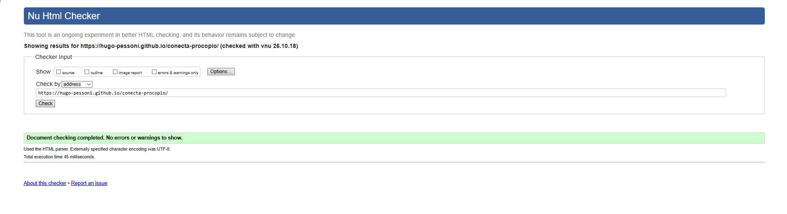
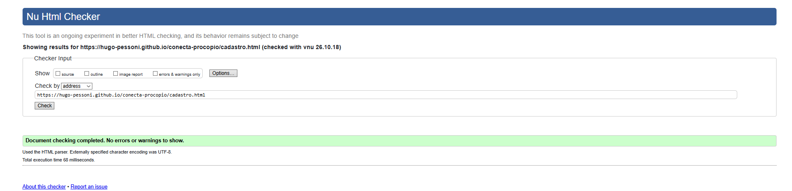
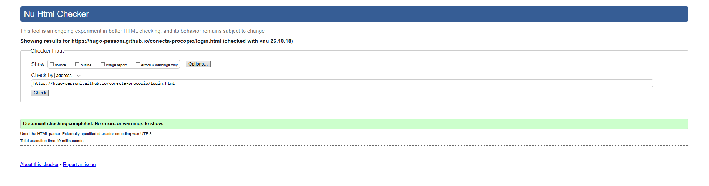
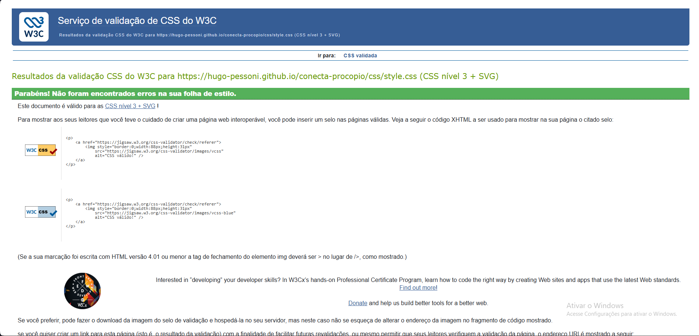

# 💻 Conecta Procópio

> Tecnologia ao alcance de todos.

Website de uma ONG fictícia de **inclusão digital** em Cornélio Procópio – PR, desenvolvido para o **Projeto Prático 1 (HTML e CSS)** da disciplina **EC47C – Programação Web Front-End (2026/02)**, ministrada pela professora Rosangela de Fátima Pereira Marquesone, na Universidade Tecnológica Federal do Paraná (UTFPR).

| | |
|---|---|
| 🌐 **Site publicado** | https://hugo-pessoni.github.io/conecta-procopio/ |
| 🎬 **Vídeo de apresentação** | https://youtu.be/QDiKWu-luj4 |
| 👤 **Integrante** | Hugo Rafael Pessoni Batista ([currículo](https://hugo-pessoni.github.io/cv-css-hugo/)) |

---

## 📌 Sobre o projeto

Muitas famílias e escolas da região ainda não têm computador em casa ou não sabem usar a tecnologia no dia a dia. Ao mesmo tempo, empresas e pessoas descartam equipamentos que ainda funcionam. A **Conecta Procópio** une as duas pontas:

1. **Doação**: recebe computadores e peças que não são mais usados;
2. **Recondicionamento**: voluntários consertam, atualizam e testam cada equipamento;
3. **Entrega**: os computadores vão para famílias e escolas cadastradas;
4. **Capacitação**: quem recebe pode fazer cursos gratuitos de informática.

O site apresenta a ONG e os cursos, e permite que a pessoa se cadastre e acesse sua conta.

### 🎯 Público-alvo

Famílias de baixa renda, estudantes e escolas públicas de Cornélio Procópio e região, além de doadores e voluntários.

### 🌍 ODS atendido

**ODS 9 – Indústria, Inovação e Infraestrutura**, em especial a meta **9.c**: *aumentar significativamente o acesso às tecnologias de informação e comunicação*. O projeto:

- amplia o acesso a computadores e à internet;
- reaproveita equipamentos que seriam descartados;
- capacita pessoas para a inovação e para o mercado de trabalho em tecnologia.

---

## 🖥️ Páginas

| Página | Arquivo | Conteúdo |
|---|---|---|
| **Principal** | `index.html` | Cabeçalho com menu, apresentação da ONG, "Como funciona", cursos gratuitos, compromisso com o ODS 9, números da ONG e rodapé com contato e currículo |
| **Cadastro** | `cadastro.html` | Formulário com 7 campos (nome, e-mail, telefone, data de nascimento, interesse, mensagem e senha). O botão de envio leva ao login |
| **Login** | `login.html` | Formulário com e-mail e senha. O botão de envio leva à página principal |

**Fluxo de navegação:** cadastro → login → página principal.

---

## 🗂️ Estrutura do projeto

```
conecta-procopio/
├── index.html          → página principal
├── cadastro.html       → página de cadastro
├── login.html          → página de login
├── css/
│   └── style.css       → folha de estilo externa, usada pelas três páginas
├── figs/               → imagens do site (ilustrações em SVG)
│   ├── logo.svg
│   ├── hero.svg
│   └── ... (uma imagem para cada curso)
├── prints/             → prints da validação no W3C
└── README.md
```

---

## 🛠️ Tecnologias e conceitos utilizados

**HTML5**
- Tags semânticas: `header`, `nav`, `main`, `section`, `article`, `aside`, `figure`, `figcaption` e `footer`
- Listas ordenada, não ordenada e de descrição (`ol`, `ul`, `dl`)
- Formulários com `label` ligado ao `id` de cada campo, `input` (text, email, tel, date, password, submit), `select`, `textarea` e o atributo `required`
- Links internos (âncoras do menu), externos e `mailto:`

**CSS3** (arquivo externo)
- Seletores de elemento, de classe e pseudo-classe `:hover`
- Modelo de caixa (`margin`, `padding`, `border`, `border-radius`, `box-sizing`)
- **Flexbox** (cabeçalho, cards, rodapé e formulários) e **Grid Layout** (seção "Como funciona")

**Recursos externos**
- Fontes: **Poppins** (Google Fonts) e **Georgia**
- Ícones: **Google Material Icons**

Nenhum framework foi utilizado.

---

## ✅ Requisitos do Projeto 1

| Requisito | Situação |
|---|---|
| Página de cadastro com 5 ou mais campos e botão que leva ao login | ✅ 7 campos |
| Página de login (e-mail e senha) que leva à página principal | ✅ |
| Cabeçalho e rodapé | ✅ `header` e `footer` |
| Menu de navegação | ✅ `nav` com 6 links |
| 2 ou mais ícones | ✅ 9 ícones |
| 4 ou mais caixas de texto (`p`, `span`, `li`, …) | ✅ |
| 5 ou mais imagens | ✅ 8 imagens |
| 3 ou mais links | ✅ |
| 4 ou mais cores | ✅ azul-escuro, amarelo, verde-água, coral e cinza-claro |
| 2 ou mais fontes, ao menos 1 externa | ✅ Poppins (externa) e Georgia |
| Tags semânticas | ✅ |
| Código validado no W3C | ✅ sem erros nem avisos (ver abaixo) |
| Publicação no GitHub Pages | ✅ |
| Currículo do integrante no rodapé | ✅ |

---

## 🔍 Validação W3C

Todas as páginas e a folha de estilo foram validadas nos validadores oficiais do W3C, **sem erros**.

### HTML: [validator.w3.org](https://validator.w3.org/)

**Página principal (`index.html`)**



**Página de cadastro (`cadastro.html`)**



**Página de login (`login.html`)**



### CSS: [jigsaw.w3.org/css-validator](https://jigsaw.w3.org/css-validator/)

**Folha de estilo (`css/style.css`)**



---

## ▶️ Como executar localmente

1. Clone o repositório:
   ```bash
   git clone https://github.com/hugo-pessoni/conecta-procopio.git
   ```
2. Abra o arquivo `index.html` no navegador, ou use a extensão **Live Server** do VS Code.

---

## 👤 Integrante

**Hugo Rafael Pessoni Batista**: [currículo](https://hugo-pessoni.github.io/cv-css-hugo/) · [GitHub](https://github.com/hugo-pessoni)

---

<sub>Projeto acadêmico. A Conecta Procópio é uma ONG fictícia, e os números exibidos no site são ilustrativos.</sub>
